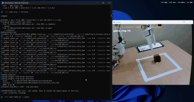
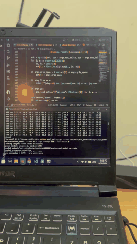
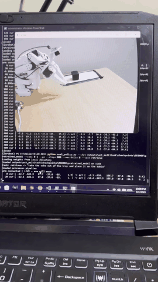
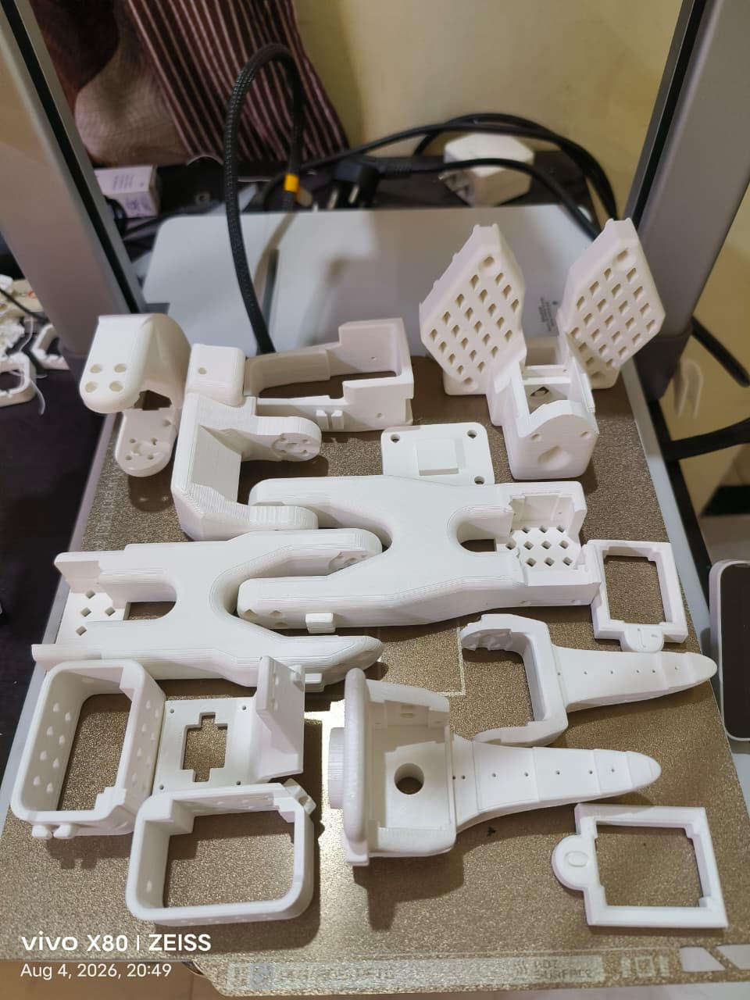
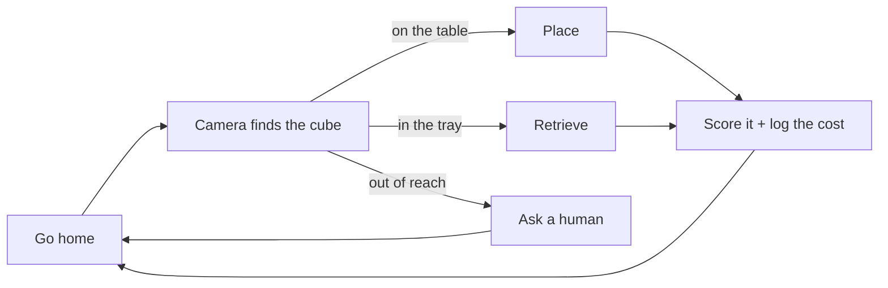
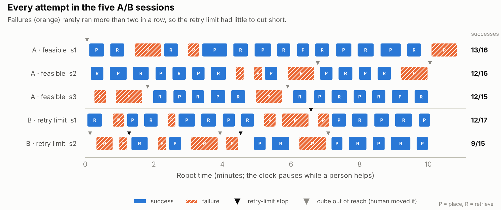

# Practice is not free 🤖

A $200 robot arm we printed ourselves, teaching itself to keep busy without us, and keeping receipts for every attempt.

 *Unattended and sped up: place, go home, look, retrieve, repeat. Spot the failure and the moment a human steps in.*

## The idea

When a robot practises on its own, every attempt costs something: seconds, servo wear, and sometimes a person who has to walk over and fix the scene. Most robot-learning methods count attempts as if they were free. **This arm keeps a receipt for each one.**

Two learned policies take turns and reset each other, so nobody has to:

- **Place:** cube from the taped square into the tray
- **Retrieve:** cube from the tray back to the square

| Place | Retrieve |
|---|---|
|  |  |

## Built, not bought

 *Every part of the arm, fresh off our printer.*

SO-101 arm · 6 hobby servos · 2 webcams (wrist + scene) · a PS5 controller for demos · about **$200** in total. Policies are [ACT](https://arxiv.org/abs/2304.13705), trained on a rented GPU in about 2 hours each.

## How it works

- The camera judges success by where the cube **touches the surface**, because perspective makes a cube inside the tray look like it's outside.
- When the arm blocks the camera, it works out "I let go over the tray" from its own joint angles.
- Every attempt goes into a CSV in `runs/`: time, joint travel, success, human help.

## Lessons learned the hard way

- 📉 **The loss curve lied.** Validation loss got worse while the real robot got better. Trust the robot.
- 🎯 **Density beats quantity.** 43 demos packed into a small square beat 51 spread across the table: **10/10** vs 8/20.
- 🏠 **Robots like routine.** The policies only work from their starting pose, so the arm goes home before every attempt.
- 🙃 **Be consistent.** Correction demos that skipped one small move (lifting after the drop) made the place policy *worse*.

## The experiment

**Should the robot keep retrying, or ask for help after 2 failures in a row?** We ran both rules for 51 minutes of robot time.

| | Keep trying (A) | Ask after 2 fails (B) |
|---|---|---|
| Success rate | **79%** (37/47) | **66%** (21/32) |
| Robot time wasted on failures | 27% | 36% |
| Human help per success | 0.14 | 0.29 |

**Verdict:** asking for help early didn't save any robot time, and it called a human twice as often. The robot rarely failed more than twice in a row, so the rule had little to fix. That's the gap a smarter, cost-aware scheduler is meant to fill, and it's what we test next.

*Fine print: a small experiment (3 vs 2 sessions, not statistically significant), and the wrist came loose and was re-attached halfway. Everything is in `runs/`. Run `python analyze.py` to check our maths.*

## Models and data

**Models:** [`act-so101-place4`](https://huggingface.co/Ved4nt/act-so101-place4) · [`act-so101-retrieve-retry`](https://huggingface.co/Ved4nt/act-so101-retrieve-retry)

**Data:** [`so101_pick3`](https://huggingface.co/datasets/Ved4nt/so101_pick3) · [`so101_place_retry`](https://huggingface.co/datasets/Ved4nt/so101_place_retry) · [`so101_retrieve_retry`](https://huggingface.co/datasets/Ved4nt/so101_retrieve_retry)

The full story, including everything that broke, is in [`LOG.md`](LOG.md).

---

Built on [LeRobot](https://github.com/huggingface/lerobot), [SO-ARM100/101](https://github.com/TheRobotStudio/SO-ARM100) and [MuJoCo Menagerie](https://github.com/google-deepmind/mujoco_menagerie).
