<div align="center">

# Practice is not free 🤖

### A robot arm we printed ourselves, practising on its own and keeping a receipt for every attempt.

[](paper/)
[](https://huggingface.co/Ved4nt)
[](https://huggingface.co/Ved4nt)
[](runs/)
[](https://github.com/huggingface/lerobot)
[](https://github.com/TheRobotStudio/SO-ARM100)

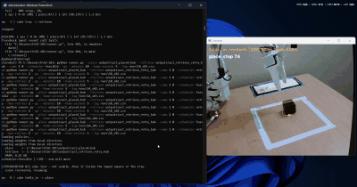

*Unattended and sped up: place, go home, look, retrieve, repeat.<br>
Watch for the failure and the moment a human has to step in.*

</div>

---

> 
>
> Every robot-learning paper that lets a robot practise on its own counts attempts as if they were free.
> **They are not.** We built the cheapest possible arm that can practise unattended, priced every single
> attempt in seconds, servo travel and human patience and found that the obvious fix,
> *"ask a human after two failures"*, makes things **worse**.

---

<div align="center">

**[ Watch a run ](#watch)** · **[ The setup ](#setup)** · **[ The loop ](#loop)** · **[ Results ](#results)** · **[ Try it ](#try)** · **[ Roadmap ](#roadmap)** · **[ Cite ](#cite)**

</div>

---

<a id="watch"></a>

## ▶ Watch one run

<div align="center">

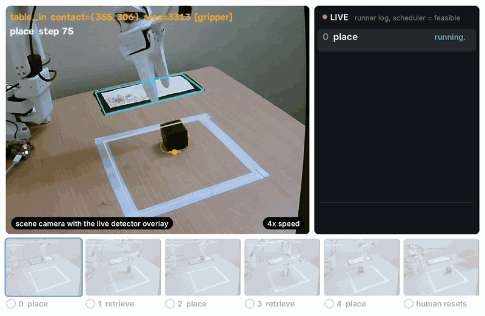

</div>

**Left:** what the robot's scene camera sees, with the detector drawn on top. The cyan box is the tray, the outline and dot are the cube and its contact point, and the label turns green when the cube lands in the tray.
**Right:** a summary of the runner's log, written as each attempt ends.
**Bottom:** one frame per attempt: four successes, one failure, then a person steps in.

<sub>Recorded at 4× speed, separately from the five sessions analysed below.</sub>

---

## Why this exists

Every attempt a robot makes on its own spends three things:

| | What it costs | What we saw |
|:---:|---|---|
| ⏱️ | **Robot time** | A failure ran up to 48 s; a success took 18 to 39 s |
| ⚙️ | **Servo wear** | Three wrist faults and a gripper overload during development |
| 🙋 | **A person's attention** | Someone has to walk over and put the cube back |

Schedulers that pick *what to practise next* count attempts, so an 18-second success and a 48-second failure that ends with a human on their feet both count as one. **This arm records what each attempt actually cost.**

---

<a id="setup"></a>

## The setup

<div align="center">

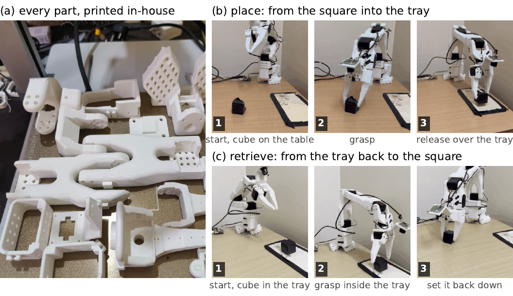

</div>

Two learned policies take turns, and each one undoes the other's work, so the loop needs no scripted reset and nobody has to watch it.

| 🟦 Place | 🟧 Retrieve |
|:---:|:---:|
| taped square → tray | tray → taped square |
| 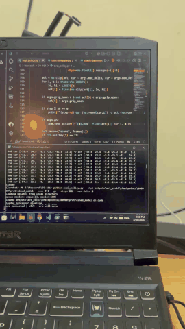 | 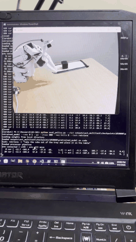 |

<details>
<summary><b>🛠️ Built, not bought: the full hardware list</b></summary><br>

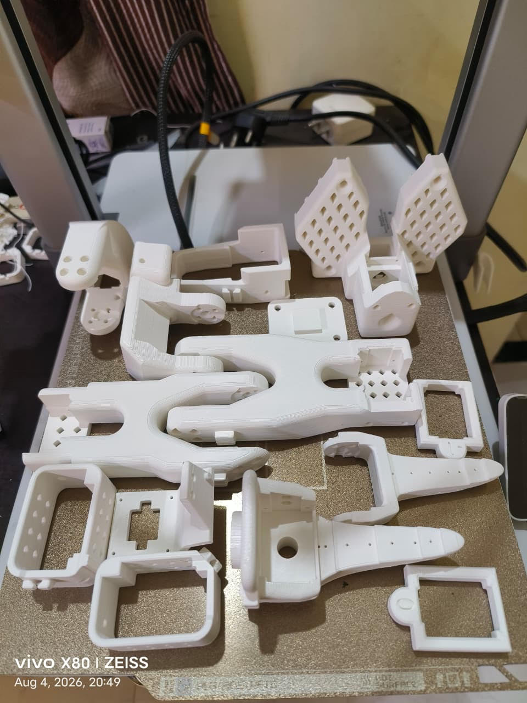

| | |
|---|---|
| **Arm** | SO-101 · 6 Feetech hobby servos · every part printed in-house |
| **Eyes** | 2 × 720p webcams: one stripped down for the wrist, one at the side |
| **Demos** | PS5 DualSense + a custom teleop script, 170+ episodes recorded by hand |
| **Brain** | [ACT](https://arxiv.org/abs/2304.13705), one policy per task, ~2 h of training each on a rented GPU |
| **Runs on** | a 6 GB RTX 2060 laptop |

</details>

---

<a id="loop"></a>

## How the loop works

<div align="center">

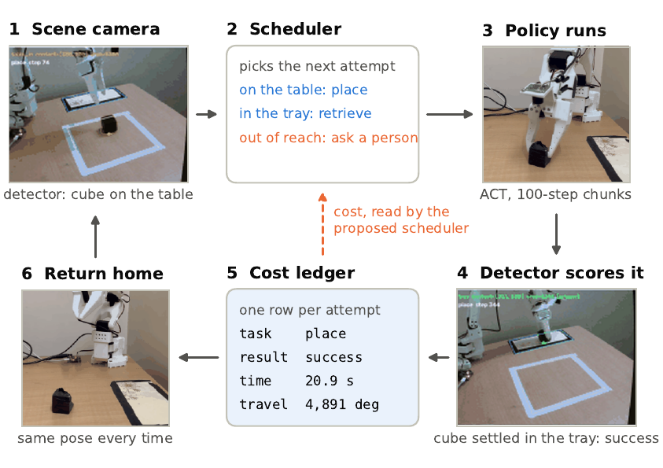

</div>

1. **Look.** The scene camera finds the cube.
2. **Choose.** On the table means `place`; in the tray means `retrieve`; out of reach means ask a person.
3. **Act.** The chosen ACT policy drives the arm.
4. **Score.** The detector decides whether it worked.
5. **Log.** One row goes into the cost ledger: time, joint travel, human help.
6. **Reset.** The arm returns home, and the loop repeats.

The dashed arrow is the point of the project: today's scheduler writes the cost down but never reads it. The next one decides with it.

<details>
<summary><b> Three detector bugs that only showed up on the real robot</b></summary><br>

| Problem | What went wrong | Fix |
|---|---|---|
| **Perspective lies** | From the side, a cube sitting *inside* the tray projects to a point *outside* it, so the robot marked its own successes as failures | Classify by the cube's **contact point** (bottom-centre of its box), not its centre |
| **Mid-air cubes** | A cube still flying through the air looks like it is already in the tray | Success needs the cube to hold still: within 6 px for 15 frames |
| **The arm hides the tray** | The gripper blocks the camera at the exact moment of release | Infer "released over the tray" from the arm's own joint angles |

</details>

---

<a id="results"></a>

## What we found

We compared two simple rules on the same arm for **51 minutes of robot time**. The session clock paused whenever a person was helping, so neither rule could buy time by asking.

| | 🔁 **A. Keep trying** | 🙋 **B. Ask after 2 fails** |
|---|:---:|:---:|
| Success rate | **79%** <sub>(37/47)</sub> | 66% <sub>(21/32)</sub> |
| Execution time lost to failures | **27%** | 36% |
| Robot seconds per success | **50.1** | 57.4 |
| Human seconds per success | **2.3** | 10.4 |

A beat B in every single session. With only 5 sessions, though, that is a strong hint, not a proof (exact session-level p = 0.1, the smallest possible with 3 vs 2 sessions).

### 1 · A quarter of the robot's time goes to neither success nor failure

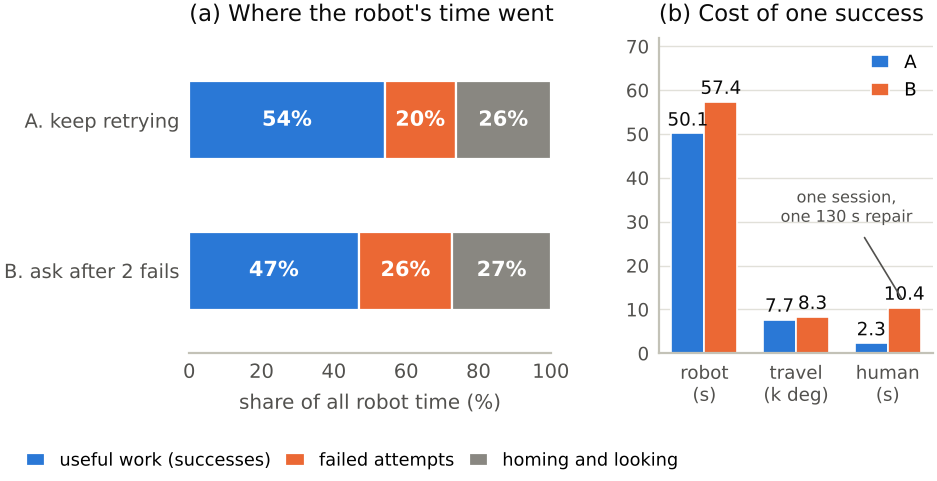

About **26% of all robot time** went to homing and waiting for the detector. That overhead is paid on every attempt, whichever rule picks it, and a success rate never shows it.

### 2 · A failure didn't predict the next one

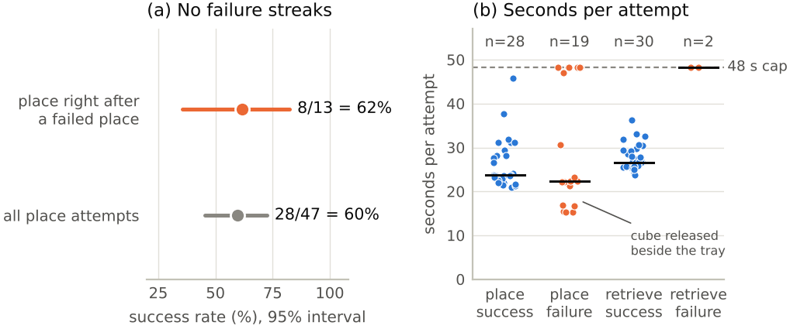

A `place` attempt straight after a failed `place` succeeded **62%** of the time, against **60%** overall. A retry was as good a bet as any other attempt, which is why "ask for help after two failures" saved no robot time. With 13 cases the interval is wide, so this says *we found no sign of streaks*, not that streaks can't happen.

Most failures were also cheap: the gripper let go early and the cube landed beside the tray. The expensive ones were the few that ran to the 48 s cap.

### 3 · The ledger separates what a rule causes from what a session costs

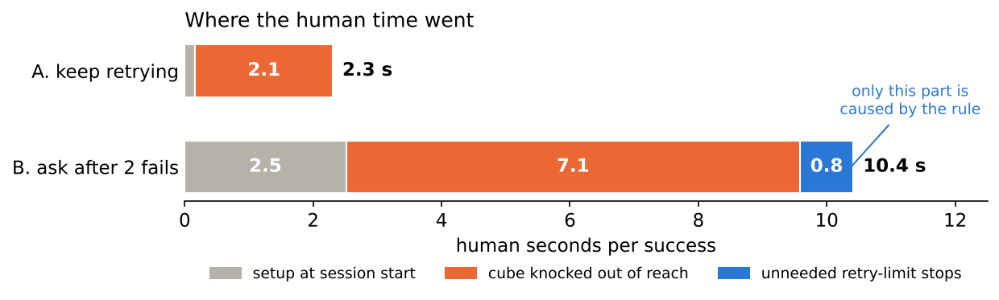

B used over four times as much human time per success, but **only 0.8 s of its 10.4 s came from the retry rule itself**. The rest was setup at the start of a session and cubes knocked out of reach, which happen under either rule. A success rate can't tell those apart. The ledger can.

### 4 · An offline check of the cost-aware rule

Before running the cost-aware scheduler on the robot, we replayed its decision rule on every logged attempt, using only what it would have known at that moment:

> **Ask for help only if a fresh start is likely enough to succeed to be worth a person's time.**

| | Result |
|---|---|
| Decision points (an attempt straight after a failure) | 10 |
| Times the rule asked for help, for every price of human time from 0.05 to 4 | **0** |
| Best estimated gain from a reset at any point | −5 points, against +17 needed to be worth asking |
| On A's sessions | Same choices as A, exactly |
| On B's sessions | Would have skipped both of B's unneeded stops |

A cost-aware rule recovers the sensible choice **without a hand-set limit**. It also shows what it needs to do better than A: situations that differ in how likely they are to fail. That is the next experiment.

<details>
<summary><b>📈 Every attempt, in order, and every session, success by success</b></summary><br>

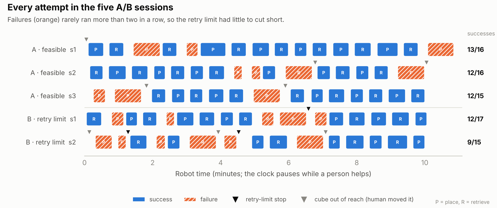

*Each block is one attempt; its width is how long it took. Long runs of failures are rare.*

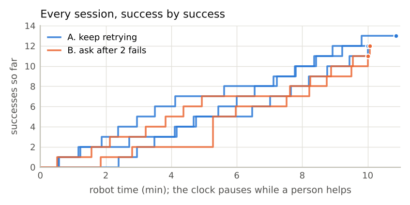

*The spread between sessions of the same rule is as wide as the gap between the rules, which is why five sessions can't settle this.*

</details>

<details>
<summary><b> The honest fine print</b></summary><br>

- **Small experiment:** 3 sessions of A against 2 of B. Pooled over attempts: Fisher *p* = 0.21. Per-session failure time: Mann–Whitney *p* = 0.40.
- **The wrist link was re-seated** after the first two sessions. B was lower than A both before (71% vs 81%) and after (60% vs 75% and 80%).
- **Two attempts under 2 s were dropped as invalid,** because the cube was still being moved by hand. Both were in one B session. Including them gives B 23/34 (68%) and changes no conclusion.
- **The offline check is a replay of the logs,** not a hardware run.
- **Check our maths:** everything is in [`runs/`](runs/). Run `python analyze.py` and `python analyze_offline.py`.

</details>

---

## Lessons learned the hard way

| | Lesson | What actually happened |
|:---:|---|---|
| 📉 | **Narrow task? Don't trust the loss curve.** | Validation loss climbed from 0.26 to 0.30 while the real robot went from *can't grasp* to *completes the task unaided*. Pick checkpoints on the robot. |
| 🎯 | **Density beats quantity.** | 43 demos packed into a small taped square beat 51 spread across the table in standalone tests: **10/10** vs 8/20. |
| 🏠 | **Robots like routine.** | On its own, `place` worked first try. In the loop it went **0 for 5**, because every demo started from home and the loop didn't. Returning home between attempts removed that failure mode. |
| 🎞️ | **Store your data as video.** | Thousands of separate images left the GPU idle waiting on the CPU. Video cut the dataset from 4.1 GB to 212 MB and training from **50 h to 12 h**. |
| 🔥 | **The servos set the schedule.** | Wrist faults and a gripper overload capped sessions at 10 minutes. Hardware wear is a cost too. |

More, including the dead ends (a simulation phase that never converged, a multi-task policy hit by gradient interference, a 450M VLA that wouldn't fit on 6 GB), is in [`LOG.md`](LOG.md).

---

<a id="roadmap"></a>

## Where this is going

- [x] A low-cost arm that practises two tasks unattended
- [x] A cost ledger for every attempt: time, joint travel, human help
- [x] First comparison of two rules (A vs B) over 51 robot-minutes
- [x] Offline replay of the cost-aware rule on the logs
- [ ] Record every step of every attempt, so the robot's own practice becomes training data
- [ ] A small RL head on top of the frozen ACT policy, learning from that practice
- [ ] Give the scheduler a real choice (two `place` policies, logged cube positions) and run it live
- [ ] Long chains of tasks, and several robots sharing one workspace

---

<a id="try"></a>

## Try it yourself

```bash
git clone https://github.com/Vedant2604/so101-cost-aware-scheduler
cd so101-cost-aware-scheduler

# 1 · find your cameras, then calibrate the workspace
python cam_check.py
python calibrate_tray.py
python calibrate_work.py

# 2 · dry run: no motion, just watch the detector and scheduler think
python runner.py --place <place_ckpt> --retrieve <retrieve_ckpt> --cams 1 0

# 3 · for real: 10 minutes under the feasibility rule
python runner.py --place <place_ckpt> --retrieve <retrieve_ckpt> \
                 --cams 1 0 --scheduler feasible --minutes 10 --go \
                 --log runs/my_session.csv

# 4 · reproduce the results
python analyze.py           # the A/B comparison
python analyze_offline.py   # failure dependence, human time by cause, the offline replay
```

**Schedulers:** `feasible` (rule A) · `retry` (rule B, `--max-retries N`) · `random` (control)

> ⚠️ Your camera angles and tray position won't match ours, so our checkpoints won't transfer as they are. Calibrate and record your own demos first. `record_demo.py` and `convert_demos.py` take you from a gamepad to a LeRobot dataset.

---

<a id="cite"></a>

## 📄 Models, data and the paper

| | |
|---|---|
| 🤗 **Models** | [`act-so101-place4`](https://huggingface.co/Ved4nt/act-so101-place4) · [`act-so101-retrieve-retry`](https://huggingface.co/Ved4nt/act-so101-retrieve-retry) |
| 🤗 **Datasets** | [`so101_pick3`](https://huggingface.co/datasets/Ved4nt/so101_pick3) · [`so101_place_retry`](https://huggingface.co/datasets/Ved4nt/so101_place_retry) · [`so101_retrieve_retry`](https://huggingface.co/datasets/Ved4nt/so101_retrieve_retry) |
| 📄 **Paper** | LaTeX source and figures in [`paper/`](paper/). Every number comes from [`runs/`](runs/). |
| 📓 **Build diary** | [`LOG.md`](LOG.md): the whole story, including everything that broke |

```bibtex
@article{telrandhe2026practice,
  title  = {Practice Is Not Free: Measuring the Embodied Cost of Reset-Free Robot Practice},
  author = {Telrandhe, Vedant and Sharma, Sushil},
  year   = {2026},
  note   = {Preprint. Code and logs: https://github.com/Vedant2604/so101-cost-aware-scheduler}
}
```

<details>
<summary><b> What's in this repo</b></summary><br>

| Path | What it is |
|---|---|
| `runner.py` | the autonomous loop: scheduler, policies, cost ledger |
| `detector.py` | cube detection and success scoring |
| `analyze.py` | the A/B comparison behind the paper's table |
| `analyze_offline.py` | failure dependence, human time by cause, and the offline replay of the cost-aware rule |
| `record_demo.py`, `convert_demos.py` | gamepad teleop to a LeRobot dataset |
| `calibrate_*.py`, `cam_*.py` | workspace, tray and camera setup |
| `eval_policy.py` | run one policy, one attempt at a time |
| `runs/` | every session log, including the pilot |
| `paper/` | LaTeX source, figures, and the scripts that rebuild them (`make_figures.py`, `make_teaser.py`) |
| `media/` | the GIFs, photos and charts on this page |
| `LOG.md` | the build diary |

</details>

---

<div align="center">

**Built on** [LeRobot](https://github.com/huggingface/lerobot) · [SO-ARM100/101](https://github.com/TheRobotStudio/SO-ARM100)

*If this is useful to you, a ⭐ helps other people find it.*

</div>
