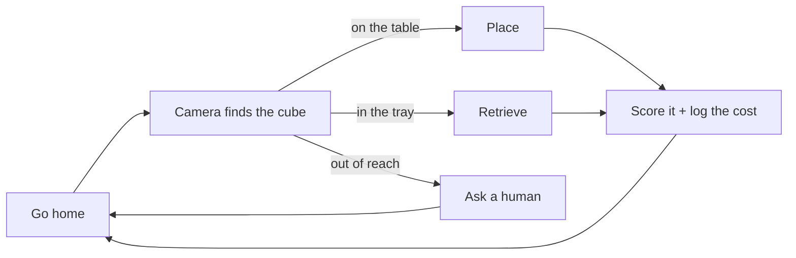

<div align="center">

# Practice is not free 🤖

### A robot arm we printed ourselves, practising on its own — and keeping a receipt for every attempt.

[](paper/)
[](https://huggingface.co/Ved4nt)
[](https://huggingface.co/Ved4nt)
[](runs/)
[](https://github.com/huggingface/lerobot)
[](https://github.com/TheRobotStudio/SO-ARM100)


*Unattended and sped up: place, go home, look, retrieve, repeat.<br>
Watch for the failure — and the moment a human has to step in.*

</div>

---

> ### The one-line version
>
> Every robot-learning paper that lets a robot practise on its own counts attempts as if they were free.
> **They are not.** We built the cheapest possible arm that can practise unattended, priced every single
> attempt in seconds, servo travel and human patience — and found that the obvious fix,
> *"ask a human after two failures"*, makes things **worse**.

---

## Why this exists

When a robot practises by itself, every attempt spends something:

| | |
|---|---|
| ⏱️ | **seconds** of robot time that could have been useful work |
| ⚙️ | **servo wear** — ours threw three wrist faults and a gripper overload during development |
| 🙋 | **a person**, who has to walk over and put the cube back |

Schedulers that decide *what to practise next* don't see any of that. They count attempts. An 18-second success and a 48-second failure that ends with a human on their feet are worth the same number: one.

**This arm writes down what each attempt actually cost, and the logs are all here.**

---

## The setup

Two learned policies take turns, and each one undoes the other's work — so the loop needs no scripted reset and nobody has to watch it.

| Place | Retrieve |
|:---:|:---:|
| taped square → tray | tray → taped square |
|  |  |

### Built, not bought


*Every part of the arm, fresh off our printer.*

| | |
|---|---|
| **Arm** | SO-101 · 6 Feetech hobby servos · printed in-house |
| **Eyes** | 2 × 720p webcams — one at the wrist, one at the side |
| **Demos** | PS5 DualSense + a custom teleop script, 170+ episodes recorded by hand |
| **Brain** | [ACT](https://arxiv.org/abs/2304.13705), one policy per task, ~2 h each on a rented GPU |
| **Runs on** | a 6 GB RTX 2060 laptop |

---

## How the loop works



Three things had to be solved before this would run on its own. Each one cost us days.

<details>
<summary><b>🔍 Perspective lies about where the cube is</b></summary><br>

A side-on camera projects a cube sitting *inside* the tray to a point *outside* the tray's outline — so the robot scored its own successes as failures. The detector now classifies the cube by its **contact point**, the bottom-centre of its bounding box, never its centroid.
</details>

<details>
<summary><b>🪂 A cube in mid-air looks exactly like a cube in the tray</b></summary><br>

A cube still travelling through the air projects into the tray region and scores early. Success now also requires the cube to hold still — within 6 px for 15 consecutive frames.
</details>

<details>
<summary><b>🙈 The arm hides the tray at the exact moment it matters</b></summary><br>

At release the gripper blocks the camera's view of the tray. The runner infers *"I let go over the tray"* from the arm's own joint angles instead, using the base-angle window learned from the demonstrations.
</details>

Every attempt lands in a CSV in [`runs/`](runs/): task, start region, success, steps, seconds, joint travel, human help.

---

## The experiment

> **Should the robot keep retrying, or ask for help after two failures in a row?**

We ran both rules for **51 minutes of robot time** — with the session clock paused whenever a human was helping, so neither rule could buy time by asking for it.


| | 🔁 Keep trying (A) | 🙋 Ask after 2 fails (B) |
|---|:---:|:---:|
| Success rate | **79%** <sub>(37/47)</sub> | 66% <sub>(21/32)</sub> |
| Robot time wasted on failures | **27%** | 36% |
| Human help per success | **0.14** | 0.29 |
| Human seconds per success | **2.3 s** | 10.4 s |

### Every second, accounted for


Reading the receipt rather than the success column turns up something neither rule touches: **about a quarter of all robot time goes to homing between episodes and waiting for the detector.** Failures cost 20% of A's time and 26% of B's — but that fixed overhead costs 26% and 27%, and every scheduler on this hardware pays it.

The three currencies also don't move together. B spent 15% more robot time per success, but **more than four times as much human time**. Which rule looks worse depends entirely on what you think a minute of someone's attention is worth.

### 🧐 The result nobody expected

Asking for help early **didn't save any robot time at all** — and it called a human **twice as often**.


Here's why. **Failures don't cluster.** A `place` attempt immediately after a failed `place` succeeded 62% of the time — against 60% for `place` attempts in general. A retry after a failure is just as good a bet as any other attempt, so bailing out early buys nothing and costs a person.

A count-based rule only pays off when failures arrive in long runs. With a policy that succeeds four times in five, they simply don't.

**That's the gap a cost-aware scheduler is meant to fill — and it's what we build next.**

<details>
<summary><b>⚖️ The honest fine print</b></summary><br>

- Small experiment: 3 sessions of A against 2 of B. Neither difference is statistically significant (Fisher *p* = 0.21, Mann–Whitney *p* = 0.40).
- The wrist link came loose between sessions 2 and 3 and was re-seated, leaving a ~3–4° tilt. One session of each condition ran before the repair, so it favours neither.
- Attempts under 2 s are dropped as invalid — the cube was still being moved by hand. There were two, both in one B session, and the rule was fixed before the comparison was computed.
- B's human cost is dominated by one bad session: 5 of its 6 interventions, including a single 130 s repair.
- Everything is in [`runs/`](runs/). Run `python analyze.py` and check our maths yourself.


*Every session, success by success. The spread between sessions of the same rule is as wide as the gap between the rules — which is exactly why five sessions can't settle this.*
</details>

---

## Lessons learned the hard way

| | Lesson | What actually happened |
|:---:|---|---|
| 📉 | **Narrow task? Ignore the loss curve.** | Validation loss climbed from 0.26 to 0.30 while the real robot went from *can't grasp* to *fully autonomous*. Same cube, same spots — overfitting our exact setup **is the point**. Judge checkpoints on the robot. |
| 🎯 | **Density beats quantity.** | 43 demos packed into a small taped square beat 51 spread across the table: **10/10** vs 8/20. Same budget, five times the coverage per cm². |
| 🏠 | **Robots like routine.** | Standalone, `place` worked first try. Inside the loop: **0 for 5**. The only difference was the starting pose. Adding a return-to-home between episodes fixed it completely. |
| 🙃 | **Be consistent, or don't bother.** | Correction demos that skipped one small move — lifting after the drop — made the `place` policy *worse*. |
| 🎞️ | **Encode your data as video.** | Raw frames left the GPU idle waiting on the CPU. Re-encoding cut the dataset 4.1 GB → 212 MB and training **50 h → 12 h**. |
| 🔥 | **The servos set the schedule.** | Three wrist-roll faults and a gripper overload capped our sessions at 10 minutes — not the algorithm, the hardware. That's an embodied cost too. |

More, including the dead ends — a simulation phase that never converged, a multi-task policy that failed on gradient interference, and a 450M VLA that wouldn't fit on 6 GB — in [`LOG.md`](LOG.md).

---

## Try it yourself

```bash
git clone https://github.com/Vedant2604/so101-cost-aware-scheduler
cd so101-cost-aware-scheduler

# 1 ─ find your cameras, then calibrate the workspace
python cam_check.py
python calibrate_tray.py
python calibrate_work.py

# 2 ─ dry run: no motion, just watch the detector and scheduler think
python runner.py --place <place_ckpt> --retrieve <retrieve_ckpt> --cams 1 0

# 3 ─ for real: 10 minutes under the feasibility rule
python runner.py --place <place_ckpt> --retrieve <retrieve_ckpt> \
                 --cams 1 0 --scheduler feasible --minutes 10 --go \
                 --log runs/my_session.csv

# 4 ─ reproduce the A/B analysis from the paper
python analyze.py
```

**Schedulers:** `feasible` (rule A) · `retry` (rule B, `--max-retries N`) · `random` (control)

> ⚠️ Your camera angles and tray position won't match ours, so our checkpoints won't transfer as-is. Calibrate and record your own demos first — `record_demo.py` and `convert_demos.py` are the path from a gamepad to a LeRobot dataset.

---

## Models, data and the paper

| | |
|---|---|
| 🤗 **Models** | [`act-so101-place4`](https://huggingface.co/Ved4nt/act-so101-place4) · [`act-so101-retrieve-retry`](https://huggingface.co/Ved4nt/act-so101-retrieve-retry) |
| 🤗 **Datasets** | [`so101_pick3`](https://huggingface.co/datasets/Ved4nt/so101_pick3) · [`so101_place_retry`](https://huggingface.co/datasets/Ved4nt/so101_place_retry) · [`so101_retrieve_retry`](https://huggingface.co/datasets/Ved4nt/so101_retrieve_retry) |
| 📄 **Paper** | LaTeX source and figures in [`paper/`](paper/) — every number in it comes from [`runs/`](runs/) |
| 📓 **Build diary** | [`LOG.md`](LOG.md) — the whole story, including everything that broke |

```bibtex
@article{telrandhe2026practice,
  title  = {Practice Is Not Free: Measuring the Embodied Cost of Reset-Free Robot Practice},
  author = {Telrandhe, Vedant and Sharma, Sushil},
  year   = {2026},
  note   = {Preprint. Code and logs: https://github.com/Vedant2604/so101-cost-aware-scheduler}
}
```

<details>
<summary><b>📁 What's in this repo</b></summary><br>

| Path | What it is |
|---|---|
| `runner.py` | the autonomous loop — scheduler, policies, cost ledger |
| `detector.py` | cube detection and success scoring |
| `analyze.py` | the A/B analysis behind the paper's table |
| `record_demo.py`, `convert_demos.py` | gamepad teleop → LeRobot dataset |
| `calibrate_*.py`, `cam_*.py` | workspace, tray and camera setup |
| `eval_policy.py` | run one policy, one attempt at a time |
| `runs/` | every session log, including the pilot |
| `paper/` | LaTeX source, figures, and the script that rebuilds them |
| `media/` | the GIFs and photos on this page |
| `LOG.md` | the build diary |
</details>

---

<div align="center">

**Built on** [LeRobot](https://github.com/huggingface/lerobot) · [SO-ARM100/101](https://github.com/TheRobotStudio/SO-ARM100)

*If this is useful to you, a ⭐ helps other people find it.*

</div>
